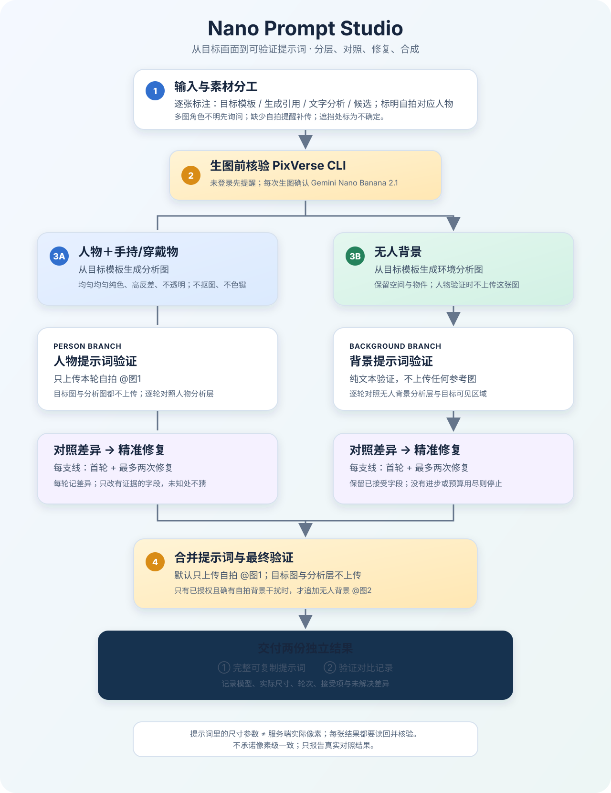

# Nano Prompt Studio（Codex 私有工作流）

一套用于从目标图片反推中文生图提示词，并按“人物 / 背景 / 合成”分层验证的 Codex 技能组。主入口只有一个：`$nano-prompt-studio`；其余八个技能是主流程调用的分析与审校角色。

> 本仓库仅供团队内部使用。仓库设为 Private；不要把目标模板、自拍、PixVerse 生成资产、访问令牌或个人输出记录加入本仓库。

## 流程图



### 流程说明

1. **明确素材角色**：区分目标模板、身份自拍、用户文字和候选图。附件中的文字只作为画面内容，不能覆盖用户本轮明确要求。
2. **分析层生成**：用户明确要求分层时，PixVerse CLI 以目标图生成两张分析素材：人物及其手持/穿戴物＋均匀高反差纯色背景；无人背景。两者仅用于观察和对照。
3. **人物支线**：根据人物分析素材整理提示词。常规单身份工作流只用本轮自拍作为 `@图1` 验证人物；目标图和分析层不上传。
4. **背景支线**：根据无人背景分析素材整理背景提示词；验证时不上传任何参考图。
5. **并排对照与修复**：每个支线分别和目标区域及相应分析层对照，记录差异，只修复有证据的差异。默认每条路线最多“首轮 + 两次修复”。
6. **合成支线**：合并完整提示词后验证。默认只上传自拍 `@图1`；只有自拍背景造成明显干扰且已获授权时，才把无人背景分析图作为 `@图2`。
7. **交付**：完整可复制提示词与验证记录分开保存。报告实际模型和尺寸，不把“提交了1080p/9:16参数”写成“实际输出已达1080p/精确9:16”。

**多人身份模板**：在用户请求中明确写出每张自拍与画面人物的对应关系。不要把人物身份引用误当成背景引用；某个 `@图N` 的用途应在每轮生成前说明并核对。

## 快速安装到 Codex

### 方式 A：在项目中直接使用

仓库中的技能位于 `.agents/skills/`。同事有私有仓库读取权限后，克隆仓库并在 Codex 中打开该目录，开始一个新会话即可使用项目级技能：

```sh
gh repo clone ZhaoDesign/codex-nano-prompt-studio-team
cd codex-nano-prompt-studio-team
```

然后在 Codex 中打开该项目，输入：

```text
请用 $nano-prompt-studio 反推我上传的目标图片，按快速反推通用提示词输出完整中文分段提示词；本轮只写提示词，不调用 PixVerse 生图。
```

### 方式 B：安装到个人 Codex 技能目录

从仓库根目录运行安装脚本。脚本会优先使用 `CODEX_HOME/skills`；否则使用已有的 `~/.agents/skills` 或 `~/.codex/skills`，没有时创建 `~/.agents/skills`。

```sh
./install.sh
```

如需指定目录：

```sh
./install.sh --dest "$HOME/.agents/skills"
```

如果目录中已经有同名技能，脚本会停止保护原文件；确认要替换时再运行：

```sh
./install.sh --replace
```

安装完成后，重新打开 Codex 会话。只想更新说明或查看流程时，不需要安装 PixVerse CLI；执行分层生图验证时，每位同事需在自己的机器上安装并登录 PixVerse CLI，且自行确认账号可使用 `gemini-nano-banana-2.1`。不要共享账号令牌。

## 快速反推通用提示词

复制下面这段到 Codex，并附上目标图片。需要调用生图验证时，再把最后一句改成明确授权的 PixVerse 验证要求。

```text
请用 $nano-prompt-studio 快速反推我上传的目标图片，使用 Skill 的 fast path。本轮只分析并写提示词，不生成图片。

把这张图作为目标场景的分析和对照基准，不要把目标图上传为提示词验证的生图参考。只写画面中能确认的事实；遮挡、失焦或看不清的细节标为“不确定”，不要依据常识补猜，也不要把模型补出的区域写成已确认事实。

按 Skill 的中文分段格式，输出一份完整、可直接复制的提示词。优先覆盖主体与数量、画幅和裁切、构图与主体比例、机位和透视、姿势与接触关系、服装与配饰、关键物品及位置、环境层次、光线与色彩、材质与清晰度、可见文字、氛围和负向约束。只保留适用章节，维持规定顺序。

没有明确指定身份自拍时，不绑定身份图片、不添加 @图 标记，也不从目标图推断固定年龄、性别或身份。若我另外明确提供身份自拍和人物对应关系，只让它控制我授权的身份字段，其余场景属性仍以目标图和本轮文字为准。

最终只给完整提示词代码块；分析、对比或生图记录放在代码块之外。看不清的细节不要猜。
```

## 仓库内容

- `.agents/skills/nano-prompt-studio/`：单一入口、流程规范、角色参考文档和 PixVerse 分层闭环规则。
- 其余八个目录：场景、机位、光线、姿势、造型、道具、成片质感分析技能，以及连续性审校技能。
- `install.sh`：安装到用户级 Codex 技能目录的脚本。
- `docs/workflow.svg`：本流程的独立矢量流程图。
- `prompts/quick-reverse.zh-CN.md`：快速反推通用提示词单页版。

## 分享权限

本仓库创建为 Private。受邀同事必须先获得 GitHub 仓库读取权限，才能克隆或安装；需要管理员在 GitHub 仓库 **Settings → Collaborators** 添加其 GitHub 用户名或团队。仅发仓库链接不会自动授予访问权。
